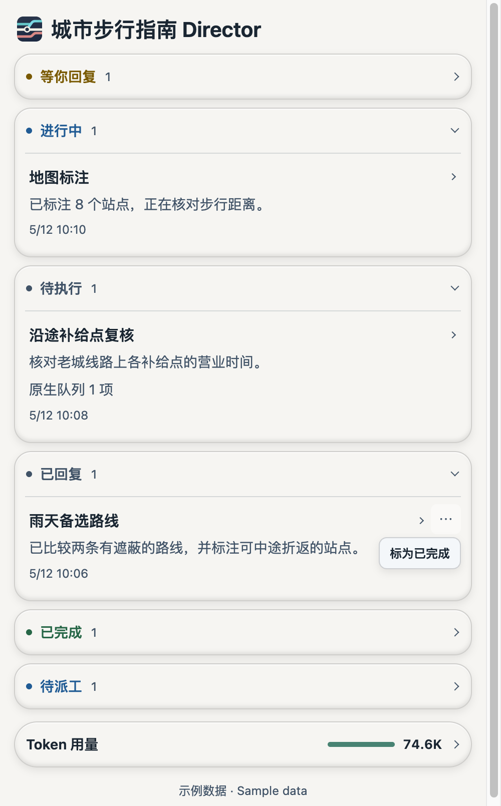
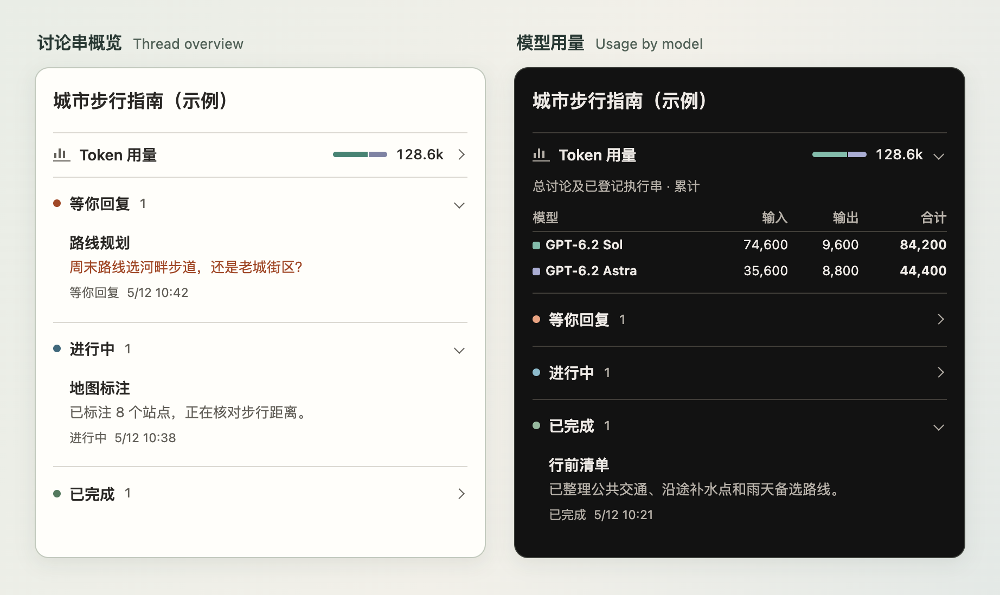

# Thread for Codex · 版本记录 / Release notes

## v1.4.0 · macOS

[macOS v1.4.0 ZIP](https://github.com/ylimingtju/thread-for-codex/releases/download/v1.4.0/thread-for-codex-macos.zip) · [Windows v1.2.1 ZIP](https://github.com/ylimingtju/thread-for-codex/releases/download/v1.2.1/thread-for-codex-windows.zip)

### **简体中文（v1.3 → v1.4 更新说明）**

v1.3 已经能帮你把任务派给不同的执行串并跟进状态，但在长期项目里用下来，真正磨人的是**反复操心上下文、总讨论越权动手，以及查进展太费劲**。v1.4 重点解决这四个痛点：

- **以前：聊久了容易选错串，总讨论还常忍不住自己干活。** 项目串一多，总讨论容易忘掉每个串长期负责什么；有时为了先摸清情况去翻代码，翻着翻着就把本该派出去的活自己干了。 **现在**：总讨论会在后台默默记下各串的长期分工，每轮都能直接看到现成的执行串名单，选串更稳；同时也收紧了边界——查改代码和跑测试明确交给执行串，总讨论专心管分配和统筹。
- **以前：项目里改了决定，得靠你自己挨个转告其他串。** 在总讨论拍板换了方案，别的执行串还停留在旧上下文里，下次追问时经常要自己重复交代一遍，很容易漏。 **现在**：总讨论统一在后台记录项目的重要决定（包括后续修改和作废）。其他执行串下次收到新消息时，会自动同步最新变动——不需要你手动维护任何资料表，也不会在没变化时反复塞冗余背景。
- **以前：总讨论收尾只甩链接，想摸清进展得自己挨个点开翻。** 上个版本里，执行串答完后总讨论通常只列一个链接；几个串并行推进时，想看谁出了结论、彼此有没有冲突，只能自己逐个串往上翻。 **现在**：总讨论可以直接读取各串精炼的问答摘要。核对交付或汇报进度时，会直接用几句话讲清核心结论、是否影响其他任务，以及需要你拍板的地方，再附原串链接方便随时细看。
- **以前：右侧面板分组太碎，而且只看得到“派了啥”，看不到“回了啥”。** v1.3 右栏有 6 个分组，略显杂乱；并且串回复完以后，卡片上往往还显示着当初的派工标题，不点进去根本不知道它答了什么或卡在哪。 **现在**：右栏精简为「等你回复、进行中、已回复、已完成」四类——排队中的任务直接标在对应条目旁，还没派过工的旧串收进底部折叠区；「等你回复」和「已回复」优先直接显示执行串的最新答复摘要，扫一眼就知道先处理哪一条。

macOS 解压 ZIP 后运行 `python3 install.py`。本机安装版的右栏交互已在隔离窗口核对，登录桌面后的跨串同步尚未实测。

---

### **English (v1.3 → v1.4 Release Notes)**

v1.3 already let you delegate tasks across separate worker chats and track their status. Over longer projects, though, the real friction came from **repeating context by hand, the main chat stepping in to do worker tasks itself, and opening multiple threads just to see where things stood**. v1.4 focuses on fixing those four pain points:

- **Before: Easy to pick the wrong chat—or watch the main chat take over the work.** As threads piled up, the main chat could lose track of who owned what; and when it peeked at code to prepare a handoff, it often ended up doing the work itself instead of delegating. **Now**: The main chat quietly tracks each worker's long-term role in the background and sees an up-to-date roster on every turn. Code inspection, edits, and tests stay with the workers, while the main chat stays focused on routing and coordination.
- **Before: Changing a decision meant manually reminding every other chat.** Once you changed direction in the main chat, parallel workers were still working off the old plan, forcing you to copy-paste updates or risk conflicting work. **Now**: The main chat maintains shared project decisions (including edits and removals) behind the scenes. Whenever another worker gets its next prompt, only the latest changes are synced in automatically—no forms to maintain, and no extra clutter when nothing has changed.
- **Before: The main chat only handed back links, leaving you to dig through threads.** In v1.3, confirmed replies usually came back as bare thread links, so checking progress across several parallel chats meant opening each one and scrolling through long logs. **Now**: The main chat reads concise Q&A digests from worker threads. When reviewing deliveries or reporting progress, it summarizes the key outcome, cross-thread impacts, and open decisions in a few lines—still linking to the original threads whenever you want the full details.
- **Before: The sidebar felt cluttered and only showed what you asked, not what came back.** With six status groups, the sidebar was noisy, and replied items often still showed your original dispatch title rather than the worker's actual answer or question. **Now**: The sidebar is streamlined to four groups—**Waiting for you**, **In progress**, **Replied**, and **Completed**. Queued work is badged right on the item, unassigned legacy chats sit neatly collapsed at the bottom, and **Waiting for you** / **Replied** rows preview the worker's actual reply so you can tell at a glance what needs attention first.

Extract the macOS ZIP and run `python3 install.py`. The installed sidebar was checked in an isolated window. Live desktop sync across chats has yet to be tested.

## v1.3 · macOS

[macOS v1.3（ZIP）](https://github.com/ylimingtju/thread-for-codex/releases/download/v1.3/thread-for-codex-macos.zip) · [Windows v1.2.1（ZIP）](https://github.com/ylimingtju/thread-for-codex/releases/download/v1.2.1/thread-for-codex-windows.zip)

### 中文

- **首次设置总讨论。** 在输入框主动选中并发送 Thread for Codex 插件或主技能即可请求设置，原启动语依然可用。已有项目总讨论或当前串已有归属时，先请你选择。需要默认命名时采用 Codex 的项目显示名，组成「项目名 Director」，已有 Director 后缀只保留一个。项目名无法确认时用「项目总讨论」。保留你指定的名称、自定义标题和重复启用时的现名。
- **接入已有聊天。** 首次登记后列出本机同项目中未归档、未配对的旧串，可跳过或逐项选择。接入与改名分别由你决定，接入后显示「待派工」。实际收到派工才计入项目用量。
- **先决定由谁处理。** 总讨论在动手前按你点名的目标、既有分工和最近相关派工选串。已有唯一明确的答案可直接引用，你也可以明确要求总讨论亲自处理。
- **执行串忙时排队。** 仅在确认目标空闲且无待启动、待排队任务时直发。独立任务遇到忙碌、已有队列或忙闲不明时，加入获授权、已配对的本机执行串原生队尾，等前项结束后另起一轮。同一笔入队重试复用队列记录。只有你明确要求立即补充同一在办任务时，才追加到当前回合。原有的派工回执现在显示「已排队」，并跟进实际执行回合。总讨论仍默认在派工后结束本轮，确认已有答复时沿用原串链接。
- **右栏区分已回复与已完成。** 等待答复和受阻任务归到「等你回复」，排队和准备中的任务归到「待执行」。每条显示一行标题、最多两行摘要和时间，优先用本轮登记的进展或交付，缺少摘要时显示本轮任务首行。在标题旁的「⋯」菜单标为已完成，或在「已完成」中重新打开。重新打开回到「已回复」，保留摘要，收到新追问才开始任务。运行中、有排队项或状态未确认时暂不可手动标记。
- **精简提示与交接。** 合并重复规则，首次设置和旧串操作按需读取，同串续派只交接本轮变化。相对 v1.3 精简前的草稿，每轮角色提示从 411 字符减至 295 字符，三份规则文档合计从 10,587 字符减至 6,713 字符。授权、队列、回执、状态和导航约定继续适用。尚无实际 Token 用量对比。

解压 macOS ZIP 后运行 `python3 install.py`。安装元数据里的 `1.3.0` 对应对外版本及标签 `v1.3`。Windows 当前可下载版本为 v1.2.1。

已有验证覆盖本机隔离环境中的入队、独立新回合和重复请求，以及面板状态相关检查。Codex 桌面端从点选插件到接入旧串、实际派工与右栏菜单点按尚未完成实测。v1.3 尚无 Windows 真机验证。

### English

- **Set up a main chat.** Select and send Thread for Codex or its main skill in the message box, or use the existing setup phrase. If the project already has a main chat or the current chat already has a role, the plugin asks you how to proceed. When a default title is needed, it uses the project name shown in Codex followed by a single “Director” suffix. If the project name is unclear, it uses “项目总讨论” (Project main chat). Explicit titles, custom titles, and titles on repeated setup are kept.
- **Add existing chats.** After first setup, choose from unarchived local chats in the same project that are not already registered. You can skip the list or decide separately which chats to add and rename. An added chat appears under **待派工** (Ready for assignment). Usage starts counting with its first project assignment.
- **Decide who handles the work before starting.** The main chat uses the thread you name, existing responsibilities, and recent related assignments to choose a worker. It can cite a single clear answer already on record, and you can ask it to handle the work itself.
- **Queue independent tasks while a worker is busy.** The main chat sends work directly only after confirming the worker is idle with no pending or queued work. If it is busy, has work queued, or its availability is unclear, an independent task joins the tail of the authorized local worker's native queue and starts in its own turn. Retrying the same submission reuses the queue entry. An immediate addition to the active turn requires an explicit request to update that same task. The existing receipt now shows **已排队** (Queued) and tracks the actual worker turn. The main chat still ends its own turn by default after dispatch and links to confirmed replies.
- **Distinguish replies from completed work in the sidebar.** Threads awaiting an answer or blocked appear under **等你回复** (Waiting for you). Queued and preparing work appears under **待执行** (Pending). Each row shows a title, up to two lines of summary, and a time. It uses the current turn's recorded progress or delivery, or the first line of the task when there is no summary. Use the **⋯** menu to mark a replied thread complete or reopen a completed one. Reopening returns it to **已回复** (Replied), keeps its summary, and waits for a follow-up before any work starts. Manual changes require an idle worker with a confirmed turn and no queued tasks.
- **Shorter prompts and handoffs.** The rules remove repeated instructions, keep setup and chat management details available on demand, and pass along the changes for each follow-up. Compared with the earlier v1.3 draft, the per-turn role prompt went from 411 to 295 characters and the three rule files from 10,587 to 6,713 characters. The rules for authorization, the queue, receipts, status, and links still apply. Actual token usage has yet to be measured.

Extract the macOS ZIP and run `python3 install.py`. The installer metadata shows `1.3.0` for the release and tag named `v1.3`. The current Windows download is v1.2.1.

Previous checks covered queueing, independent turns, and repeated requests in an isolated local environment, as well as sidebar status handling. The full desktop flow from selecting the plugin through adding chats, dispatching work, and using the sidebar menu has yet to be tested. v1.3 has yet to be tested on Windows.

## 1.2.1 · macOS / Windows

[macOS v1.2.1（ZIP）](https://github.com/ylimingtju/thread-for-codex/releases/download/v1.2.1/thread-for-codex-macos.zip) · [Windows v1.2.1（ZIP）](https://github.com/ylimingtju/thread-for-codex/releases/download/v1.2.1/thread-for-codex-windows.zip)

Windows 安装包来自 momo-land 验证的提交 [`c1eb6dd`](https://github.com/ylimingtju/thread-for-codex/tree/c1eb6dd0d83b2fdb722032454e4ea4e3568649f5)。Windows 11 实测覆盖从 v1.1.0 升级保留已有登记，以及登录桌面端后的设置、派工和回执跳转。[实测记录](https://github.com/ylimingtju/thread-for-codex/pull/3)

The Windows ZIP uses commit [`c1eb6dd`](https://github.com/ylimingtju/thread-for-codex/tree/c1eb6dd0d83b2fdb722032454e4ea4e3568649f5). On Windows 11, momo-land verified that an upgrade from v1.1.0 kept existing chat registrations, and tested setup, assignment, and receipt links in the signed-in desktop app. [Test results](https://github.com/ylimingtju/thread-for-codex/pull/3)

### 中文

- **首次设置总讨论时自动命名。** 新聊天的标题为空、是默认占位名或仅复述启动语时，用「项目名 Director」。无法确认项目名时用「项目总讨论」。用户指定的标题优先，已有自定义标题保留，重复启用沿用现名。
- 中英文首页分别标明 macOS 和 Windows 可下载的版本，并在封面下方加入项目介绍视频。

### English

- **Name a main chat on first setup.** If the new chat has no title, has a default title, or just repeats the setup request, the plugin uses “Project Name Director.” If it cannot identify the project, it uses “项目总讨论” (Project main chat). A title you specify takes priority. Existing custom titles are kept, and repeated setup keeps the current title.
- Both READMEs list one downloadable version per platform and show the project introduction video beneath the cover.

## 1.2.0 · macOS

[下载 macOS v1.2.0 / Download for macOS](https://github.com/ylimingtju/thread-for-codex/releases/download/v1.2.0/thread-for-codex-macos.zip)

### 中文

- **派工后可以接着安排工作。** 总讨论发出任务并登记后默认结束本轮，明确要求等待时才持续跟进。执行串答完后，原串链接显示在聊天中的派工回执里。总讨论正忙时，回执等当前轮结束后更新。总讨论可直接引用已有答案，调查、新判断和文件修改交给执行串。
- **在原串查看答复。** 总讨论把问题交给执行串后，收到本轮答复时默认只提供执行串名称和链接。明确要求汇总或比较时，总讨论再整理答复。
- **右侧面板采用透明玻璃分组。** 浅色与深色跟随 Codex 主题。「等你回复」「进行中」「已完成」分别用黄、蓝、绿区分。底部的 Token 用量默认收起，展开可查看各模型的用量和占比。累计范围提示已移除，数字以大写 K 或 M 缩写，最多保留一位小数。
- **减少重复处理。** 派工记录的读取及来源、目标核对使用同一套逻辑。任务列表不变时沿用原分组，用量可以独立更新。任务组与用量区复用折叠样式。

升级时解压 macOS 安装包并运行 `python3 install.py`。在 Codex「设置 → Hooks」审查并信任插件的三条规则，当前任务结束后重启 Codex。

### English

- **Keep working after assigning a task.** Once the main chat sends and registers an assignment, it ends the turn by default. Ask it to wait when you need the result before continuing. The assignment receipt shows the worker chat link when the reply is ready and the main chat is idle. The main chat can answer from existing results and delegates investigation, new judgments, and file changes.
- **Read answers in the original chat.** After delegating a question and receiving the reply, the main chat provides the worker chat’s name and link by default. Ask the main chat to summarize or compare replies when needed.
- **Transparent task groups in the side panel.** The panel follows the Codex light or dark theme. Yellow, blue, and green distinguish threads waiting for you, in progress, and complete. The token usage row at the bottom starts collapsed. Expand it to see counts and shares by model. The time-range note has been removed, and counts use uppercase K or M with up to one decimal place.
- **Less repeated work.** The dispatch code shares the logic for reading records and checking their source and target. The panel keeps the current groups when the task list stays the same and updates usage independently. Task groups and the usage row share the same disclosure styles.

To update, extract the macOS ZIP and run `python3 install.py`. Review and trust the plugin's three hooks under Settings → Hooks, then restart Codex after your active tasks finish.

## 1.1.1 · macOS

[下载 macOS v1.1.1 / Download for macOS](https://github.com/ylimingtju/thread-for-codex/releases/download/v1.1.1/thread-for-codex-macos.zip)

### 中文

- **从新答复打开面板。** 总讨论每条新答复末尾都有「打开项目讨论串」。在支持插件链接的 Codex 桌面端，点击即可查看当前总讨论的任务。首次点击时，Codex 可能询问用哪个插件打开。
- 此前仅在本机试用的旧版文件查看器方案已撤回。如果右侧出现两个同名标签，可以关闭多余的标签，保留正在使用的一个。
- **直接在旧执行串追问。** 已登记的执行串在恢复时按聊天 ID 找回所属总讨论，新答复末尾附「← 返回总讨论」。无需重新派工。**强烈建议每个项目只设一个总讨论**，其余聊天用作执行串。
- **补正时保留完整答复。** 正确的末行链接只在本机检查。缺失或指向错误时，插件最多请求模型补正一次，要求保留完整正文和成果链接。如果总讨论只读到补充的链接，会回原串取完整交付再汇总。

升级后，在「设置 → Hooks」审查并信任本插件的 `SessionStart`、`UserPromptSubmit` 和 `Stop`。当前任务结束后，退出并重新打开 Codex，让已有聊天载入更新。[Codex Hooks 说明](https://learn.chatgpt.com/docs/hooks#stop)

### English

- **Open the panel from a new reply.** Each new main-chat reply ends with **打开项目讨论串** (Open project threads). Select it to see that chat’s tasks on the right in a Codex desktop version that supports plugin links. Codex may ask which plugin to use on first click.
- The older file-viewer approach was tried only locally and has been withdrawn. If two tabs with the same name appear on the right, you can close the extra tab and keep the one you’re using.
- **Follow up in an existing worker chat.** When a registered worker resumes, the plugin looks up its main chat by ID and adds **← 返回总讨论** (Back to main chat) to new replies. You can continue in the same chat without a new assignment. **We strongly recommend one main chat per project.**
- **Keep the full answer when correcting a link.** A correct final link needs only a local check. For a missing or incorrect link, the plugin asks for at most one correction, with the full answer and its deliverable links. If the main chat receives only a link, it reads the worker’s full reply before summarizing.

After upgrading, review and trust the plugin’s `SessionStart`, `UserPromptSubmit`, and `Stop` hooks under Settings → Hooks. When your active tasks finish, quit and reopen Codex to load the update in existing chats. [Codex hook reference](https://learn.chatgpt.com/docs/hooks#stop)

## 1.1.0 · macOS / Windows

[下载 macOS v1.1.0 / Download for macOS](https://github.com/ylimingtju/thread-for-codex/releases/download/v1.1.0/thread-for-codex-macos.zip) · [当前 Windows 下载 / Current Windows download](https://github.com/ylimingtju/thread-for-codex/releases/download/v1.2.1/thread-for-codex-windows.zip)

当时的 Windows 安装包来自提交 `5bd50f4`。安装、升级和返回链接已有 Windows 11 测试记录，登录桌面后的人工点按仍待确认。[更新说明、测试记录与使用指南](docs/release-v1.1.0.md#zh)

The Windows v1.1.0 ZIP used commit `5bd50f4`. Installation, upgrades, and worker return links were tested on Windows 11. A click-through in the signed-in desktop app is pending. [Release notes, test results, and user guide](docs/release-v1.1.0.md#en)

总讨论直接回答有明确出处的已有结论，把需要新判断或修改的工作分派给执行串。续派时沿用原串上下文，回报时概括本轮结果并保留原串入口。九个专项技能仍可按需调用，普通派工省去流程声明和重复记录。新旧执行串在每条面向用户的答复末尾提供「← 返回总讨论」链接。

The main chat answers questions about established results and delegates work that calls for a new judgment or a change. Follow-ups reuse the original thread. The main chat summarizes the current assignment and links to the source when helpful. All nine specialist skills remain available. Routine assignments can proceed without extra workflow messages or duplicate records. Each reply to the user in a new or existing worker chat ends with a link back to its main discussion.

## 1.0.4

支持 Windows 版 Codex 桌面端。安装器可使用桌面端自带的命令行，并将面板绑定到安装时使用的 Python。面板支持中文任务数据和通过 Windows 打开原生聊天。

Added support for Codex desktop on Windows. The installer can use the bundled Codex CLI and configures the panel to use the Python executable that ran the installer. The panel handles Unicode task data and opens native chats through Windows.

## 1.0.3

- 在新项目或已有项目的聊天中发送「将此线程作为该项目的总讨论」即可启动。也可以在同一条消息里附上第一个任务。原来的技能命令仍然可用。
- 修复聊天中「项目讨论串」入口下方的大片留白。单行入口的初始高度为 49 像素，内容增多时可随之展开。

- In a new or existing project, say “Use this chat as the main discussion for this project.” You can include the first task in the same message. The original skill command still works.
- Fixed excess space below the project threads card in chat. The card starts at 49 pixels and grows with its content.

## 1.0.2

插件图标换为「换乘线」。深蓝底上的三条线路与白色换乘环呼应项目总讨论与执行串。

The new plugin icon uses three transit lines and a white interchange ring on a navy background to represent a project chat and its threads.

## 1.0.1

总讨论在所有受支持的推理强度下都可以派工、追问和验收。新建总讨论时仍默认使用 `xhigh`（模型支持时）。在 Codex 中手动调整强度后，继续对话或收到执行串回报时都会沿用当前选择。

The main chat can assign tasks, follow up, and accept results at any supported reasoning effort. New main chats still default to `xhigh` where supported. Continuing a chat or receiving a worker callback preserves the effort you selected in Codex.

## 1.0.0

### 中文

首个独立编号版本，适用于 macOS 版 Codex。总讨论可向新串或已有聊天派工。右侧面板按「等你回复」「进行中」「已完成」分组，点开标题可回原串继续问。面板跟随聊天改名，并按模型累计项目的输入和输出 Token。

下载源码包并解压，在根目录运行 `python3 install.py`。[中文安装说明](README.md#安装与启动)

### English

The first independently numbered release for Codex on macOS. A main project chat can assign tasks to new or existing threads. The sidebar groups them by waiting for a reply, in progress, or complete. Open a thread to follow up, even after completion. Thread names follow Codex, and the panel tracks project input and output tokens by model.

Extract the source ZIP and run `python3 install.py` from its root. [English installation guide](README.en.md#install-and-start)
