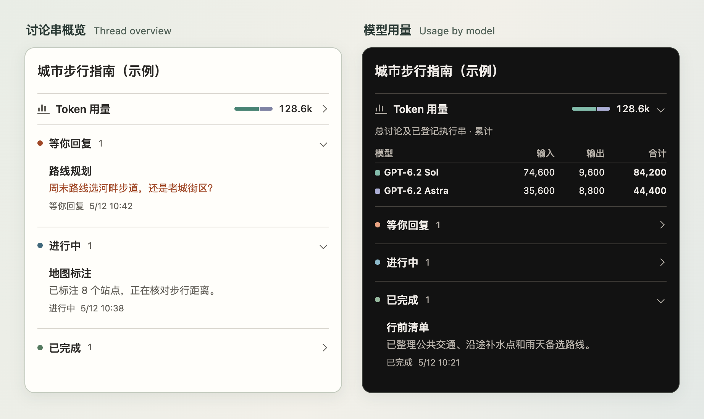

# Thread for Codex

**Inspired by Claude Projects, Thread for Codex lets you delegate tasks from one project chat and follow up in each thread.**  
受 Claude Projects 启发，Thread for Codex 让你在项目总讨论里分派任务，点开对应讨论串就能继续追问。

[中文](README.md) · English

**[Download for Windows / macOS (ZIP)](https://github.com/ylimingtju/thread-for-codex/releases/latest/download/thread-for-codex.zip)** · [Installation instructions](#install-and-start)


Thread for Codex adds a project thread panel to Codex for macOS and Windows. For a city walking guide, you could keep editorial decisions in the main chat, ask one thread to plan the route, and ask another to check the map. When the route planner needs you to choose between the riverfront and the old town, its question appears in the sidebar. Open the thread to answer, then return to the main chat for the summary.



*The plugin's panel in light and dark mode, rendered with fictional tasks and usage figures. The panel labels are in Chinese.*

## Install and start

You need a signed-in Codex desktop app, a Codex CLI that supports `codex plugin`, and Python 3.9 or later. The plugin uses only the Python standard library.

1. Clone the repository or extract the release ZIP. On macOS, choose a folder you plan to keep. Run the command for your system from the source folder.

   | System | Install command |
   | --- | --- |
   | Windows PowerShell | `py -3 .\install.py` |
   | macOS | `python3 install.py` |

   On Windows, you can also run `python .\install.py` or use the full path to Python, for example `& 'C:\Python312\python.exe' .\install.py`. The installer looks for `codex.exe` in the Microsoft Store edition of Codex first, then in PATH and the usual standalone CLI location. Use `--codex 'C:\path\to\codex.exe'` to select a specific executable.

2. Open a new or existing project. In the chat you want to use as the main discussion, send

   ```text
   Use this chat as the main discussion for this project.
   ```

3. Give it a task. For example, “Ask the route planner for two weekend routes and the map thread to check the stops.” On first launch, the plugin pins the main chat and opens the project panel. Use the **项目讨论串** entry in that chat to reopen it later.

A new main chat defaults to `xhigh` reasoning if the model supports it and you have not selected an effort. An existing chat keeps its current setting. You can change the effort at any time and still assign work, follow up, and accept results.

To update, rerun the install command from the updated source folder. If you cloned the repository, run `git pull --ff-only` to update it first. The Windows installer prepares a local marketplace in the Codex data directory and records the Python executable used for installation. If you move or replace Python, rerun the installer with its new path.

## Using the sidebar

| What you want to do | Where to go |
| --- | --- |
| Answer a question | **等你回复** lists the questions that need your input. **进行中** includes work delivered by a thread and awaiting review in the main chat. |
| Use an existing thread | Name it in the main chat. Include its chat link if two names match. After a successful assignment, it appears in the panel with its original context. |
| Follow up after completion | Expand **已完成**, open the chat by its title, and type your follow-up. The next turn moves the thread back to **进行中**. You choose when to archive it. |
| See usage by model | Expand **Token 用量** for input, output, and total tokens. Counts include the main chat and registered threads. A reused thread counts from its first project assignment. Model changes are counted separately, and the panel flags gaps in the records. |

Each main chat lists the threads it assigned work to, even if another project chat uses the same folder. Renaming a chat in Codex updates the title on the next panel refresh.

## Local data and switching versions

The panel stores its registry at `~/.codex/codex-director/panel.sqlite3`, or under `CODEX_HOME` if set. It reads task status and token counts from Codex's local records. Refreshing the panel does not call a model. See the [privacy notes](PRIVACY.md).

If the original plugin is installed, the installer keeps it and enables Thread for Codex. To switch back, add `--restore-original` to the install command. If an open Codex window still shows the old plugin entry, save your work and reopen the app.

## Credits and license

Thread for Codex has its own version sequence starting at `1.0.0` and keeps the original skill name for existing projects. The workflow builds on Claire Novotny LLC's [Codex Director 0.8.18](https://github.com/novotnyllc/codex-director/tree/f3470cd1b8cdf45ebff110ea22ca5c311674841c). The sidebar integration follows the approach used by [Codex Agent Panel](https://github.com/ylimingtju/codex-agent-panel).

[How Claude Projects organizes threads](https://code.claude.com/docs/en/claude-projects#how-a-project-is-organized) · [MIT license](LICENSE) · [Release notes](CHANGELOG.md)
