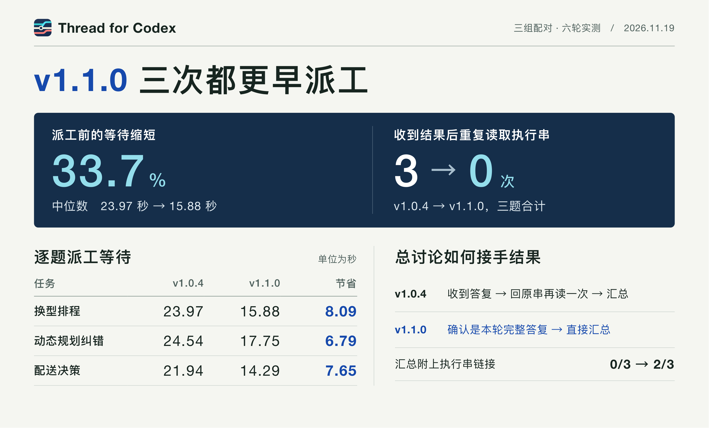
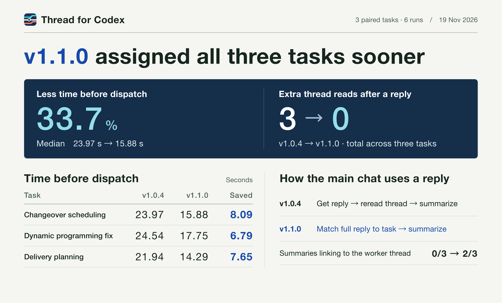

# Thread for Codex v1.1.0

[中文](#zh) · [English](#en)

## 中文

**Windows v1.1.0 发布记录。** 当时的安装包来自提交 `5bd50f4`。momo-land 已在 Windows 11 上验证全新安装、重装、从 v1.0.4 升级保留讨论串，以及执行串的返回链接规则。解压 ZIP 后，在含有 `install.py` 的目录运行 `py -3 .\install.py`。登录桌面后派工、打开旧串和点回总讨论仍待确认。[当前 Windows 安装包（v1.2.1）](https://github.com/ylimingtju/thread-for-codex/releases/download/v1.2.1/thread-for-codex-windows.zip) · [macOS v1.1.0](https://github.com/ylimingtju/thread-for-codex/releases/download/v1.1.0/thread-for-codex-macos.zip) · [Windows 测试记录](https://github.com/ylimingtju/thread-for-codex/pull/3)

在总讨论里交代任务，到执行串里看细节、继续追问。v1.1.0 改了交接方式。执行串交付后，总讨论先确认答复属于本轮任务。结论和依据齐全时，它直接汇总；答复有截断或对应不上本轮任务时，它会回原串核对。

在同一台 Mac 上，三道题在 v1.0.4 和 v1.1.0 中各测一次。总讨论从开始处理请求到发出派工，等待时间的中位数从 **23.97 秒降至 15.88 秒**，缩短 **33.7%**。收到结果后，三题合计重复读取执行串的次数从 **3 次降至 0 次**。

### 第一次使用

1. **把当前聊天设为总讨论。** 安装插件后，打开一个新项目或已有项目，进入你想保留为总讨论的那条聊天，直接发送 **「将此线程作为该项目的总讨论。」** 已有聊天保留原名和历史。你可以在同一条消息里附上第一个任务。
2. **用一句话派工或交接。** 例如「请新建一个路线串，比较周末的两条步行路线，选出一条。」等它交付后，再说「请新建一个地图核对串，把刚选定的路线交给它核对站点。」总讨论把任务发进对应的 Codex 聊天；有前后依赖时，把前一个串已确认的结果交给下一个串。你在总讨论看摘要，点右侧面板里的任务标题能进入执行串，用原来的输入框追问。
3. **置顶后，到左侧栏找原聊天名。** 首次设置总讨论时，插件会把它置顶。原来项目名下的条目可能不再显示。打开左侧栏，找到「项目」上方的 **「置顶」**。如果分组折叠，点标题旁的箭头展开，再按原聊天名打开。也可以点左上角的搜索图标查原名，或点执行串最新答复末尾的 **「← 返回总讨论」**。要重新打开右侧面板，在总讨论的 **「项目讨论串」** 卡片上点 **「在右侧打开 ›」**。

### 常见问题

| 问题 | 回答 |
| --- | --- |
| 旧项目里已经有几条工作串，还要重建吗？ | 可以直接说「让已有的『地图核对』串检查这版路线」。如果有重名，附上目标聊天的链接。成功派工后，旧串会带着原有上下文出现在这个总讨论的面板里。 |
| 旧串里找不到「← 返回总讨论」怎么办？ | 旧消息保留原样。总讨论向这条旧串派工后，从它的新答复末尾找链接。当前答复里没有链接时，可以从左侧「置顶」回去。 |
| 为什么面板里没有同目录的其他聊天？ | 面板按实际派工关系列串。刚设好总讨论时可以是空的。新串还在创建时会显示「准备中」，取得正式聊天 ID 后即可点开。 |
| 我该在总讨论问，还是到执行串问？ | 想回顾已有结论、调整分工或让两个串协作，就在总讨论说。想看某个细节或继续追问同一位执行者，就点开对应串。「等你回复」列出需要你决定的问题。「待总讨论确认」表示执行串已交付，正在等总讨论核对。 |
| 我说了「先转发，稍后再看」，结果会自动弹出来吗？ | 需要这一轮就拿到结果，可以说「等它完成，再给我汇总」。如果总讨论的这一轮已经结束，执行串完成后不会自动唤醒它。回来问「刚才那条路线核对得怎么样？」即可接着看。 |
| 已完成的串还能继续用吗？ | 可以。展开「已完成」，点标题继续问；新一轮追问会把该串移回「进行中」。你决定什么时候归档。 |
| 一定要选 `xhigh` 吗？ | 你可以选模型支持的任何推理强度。已有聊天沿用当前设置。只有新总讨论尚未选择强度且模型支持时，才默认使用 `xhigh`。 |
| Windows 和 macOS 是否还要另装原版 Codex Director？ | 两个平台都只需安装 Thread for Codex。如果自然语言启动没有生效，确认插件已启用，在目标聊天发送 `$codex-director:codex-director 将此线程作为该项目的总讨论。`。[安装与升级说明](../README.md#安装与启动) |

## English

**Windows v1.1.0 release record.** Its ZIP used commit `5bd50f4`. On Windows 11, momo-land verified fresh installation, reinstallation, an upgrade from v1.0.4 that preserved registered chats, and the worker return-link hook. Extract the ZIP and run `py -3 .\install.py` from the folder containing `install.py`. Assignment, sidebar navigation, and the return link still need a click-through in the signed-in desktop app. [Current Windows ZIP (v1.2.1)](https://github.com/ylimingtju/thread-for-codex/releases/download/v1.2.1/thread-for-codex-windows.zip) · [macOS v1.1.0](https://github.com/ylimingtju/thread-for-codex/releases/download/v1.1.0/thread-for-codex-macos.zip) · [Windows test results](https://github.com/ylimingtju/thread-for-codex/pull/3)

Give an assignment in the main chat, then open the worker chat to see the detail or ask a follow-up. In v1.1.0, the main chat checks that the reply belongs to the current assignment. When the reply includes the conclusion and the evidence it needs, it summarizes it directly. If the reply is cut off or belongs to a different turn, it opens the worker chat to check.

We ran each of the three tasks once per version on the same Mac. From the moment the main chat started handling a request to the moment it sent the assignment, the median wait fell from **23.97 to 15.88 seconds**, a **33.7% reduction**. Across the three tasks, the main chat reopened a worker chat to reread a delivered result **three times in v1.0.4 and zero times in v1.1.0**.

### Getting started

1. **Make the current chat your main discussion.** After installing the plugin, open a new or existing project, enter the chat you want to use, and send **“Use this chat as the main discussion for this project.”** An existing chat keeps its title and history. You can include your first assignment in the same message.
2. **Ask the main chat to assign work or pass a result along.** Try “Create a route-planning chat. Compare two weekend walks and recommend one.” Once it delivers, say “Create a map-checking chat and give it the chosen route so it can verify the stops.” Each assignment arrives in a regular Codex chat. When one task depends on another, the main chat passes the confirmed result to the next worker. Read the summary in the main chat, or click a task title in the right panel to ask a follow-up.
3. **Find the pinned chat by its original title.** On first setup, the plugin pins the main chat. Its entry may disappear from the project folder in the left sidebar. Above **Projects**, find **Pinned**. If it is collapsed, click the arrow beside the heading, then open the chat by its original title. You can also use the search icon at the top left to find it or use **← 返回总讨论** (“Back to main chat”) at the end of a worker reply. To reopen the right panel from the main chat, click **在右侧打开 ›** (“Open on the right”) on the **项目讨论串** (“Project threads”) card.

### Frequently asked questions

| Question | Answer |
| --- | --- |
| Can I use a chat that already has project history? | Yes. Say “Ask my existing ‘Map check’ chat to review this route.” If two chats have the same title, include the link to the one you want. Once the assignment goes through, it appears in this main chat’s panel with its history intact. |
| Where is the back link in an older worker chat? | Look at the end of a new reply after the main chat has assigned work to that chat. Earlier messages keep their original text. If the current reply has no link, open the main chat from **Pinned**. |
| Why are other chats from the same folder missing from the panel? | The panel lists chats that received assignments from this main chat. It can be empty at first. A newly created chat may show **准备中** (“Preparing”) until Codex supplies its chat ID and the title becomes clickable. |
| Where should I ask a follow-up? | Use the main chat to recall a conclusion, change who owns a task, or pass work from one chat to another. Open the worker chat for details. **等你回复** (“Waiting for you”) lists questions that need your decision. **待总讨论确认** means the worker has delivered and the main chat still needs to review the result. |
| If I say “Just forward it,” will the result appear on its own? | Say “Wait for the result and summarize it here” to get the result in the current turn. Once that turn ends, a worker finishing does not wake the main chat. When you return, ask “What did the map check find?” |
| Can I reopen a completed task? | Yes. Expand **已完成** (“Completed”), click the title, and send a follow-up in the same chat. The next turn moves it back to **进行中** (“In progress”). You choose when to archive it. |
| Do I have to use `xhigh` reasoning? | Use any reasoning effort your model supports. Existing chats keep their settings. A new main chat defaults to `xhigh` only when no effort was selected and the model supports it. |
| Do I also need the original Codex Director on Windows or macOS? | Thread for Codex includes what it needs from Director. If the starter phrase does not activate it, check that the plugin is enabled, then send `$codex-director:codex-director Use this chat as the main discussion for this project.` in your chosen chat. [Installation and upgrades](../README.en.md#install-and-start) |
